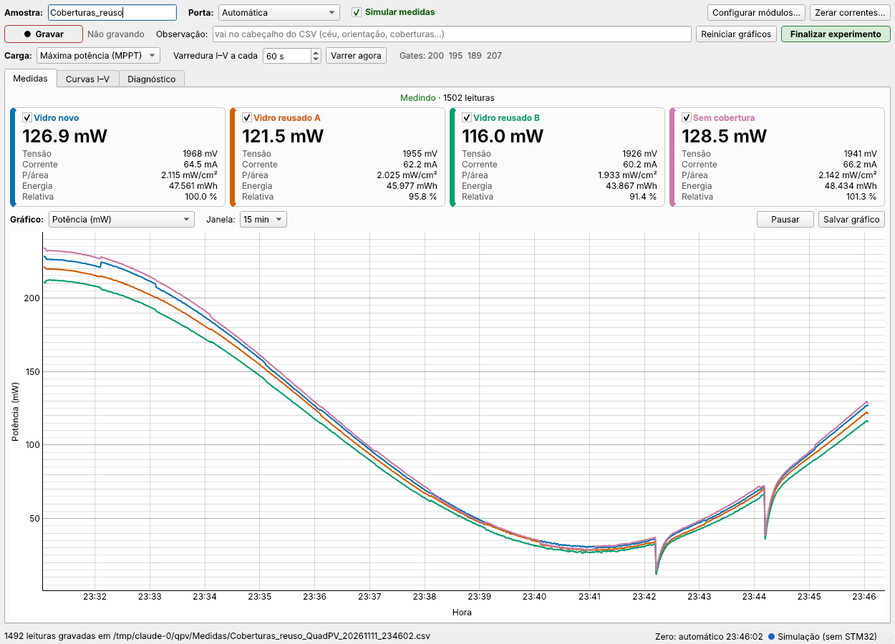
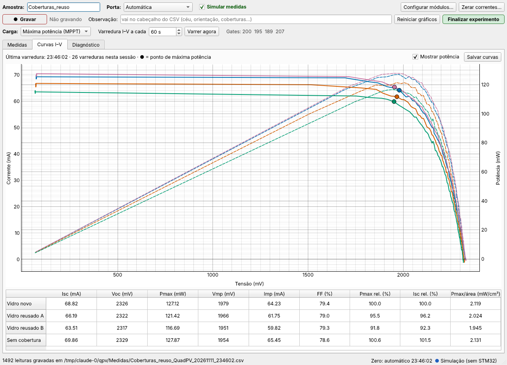

# QuadPV: quatro módulos fotovoltaicos medidos lado a lado com STM32

Sistema de baixo custo para comparar **quatro módulos fotovoltaicos pequenos e idênticos** sob as mesmas condições, por exemplo com coberturas de vidro diferentes. Um **STM32F103C8T6 (Blue Pill)** mede a tensão e a corrente de cada módulo e envia as médias de cada segundo por USB.

Cada módulo tem uma **carga eletrônica** (MOSFET controlado por um amplificador operacional). Com ela o firmware:

- mantém cada módulo no **ponto de máxima potência**;
- mede a **curva I–V** dos quatro a cada minuto, quando passa uma nuvem ou sob comando.

A interface em Python mostra em tempo real potência, tensão, corrente, energia, curvas I–V, Isc, Voc, Pmax e fator de preenchimento, compara os módulos entre si e grava tudo em CSV.



```
            ┌──────────────── sensor de referência (sem corrente) ── A0
            │
 módulo 1 (+) ──┬──────────────────────────────────────────────── A5 (tensão)
                └── WCS2702 ── carga R ── GND        saída ─────── A1 (corrente)
 módulo 1 (−) ── GND
   ... idem para os módulos 2, 3 e 4: corrente em A2, A3, A4; tensão em A6, A7, A8
                                                     ┌────────┐
                                     A0..A8 ───────► │ STM32  │ ── USB ──► PC: QuadPV
                                                     │ F103   │
                                                     └────────┘
```

## Hardware

| Componente | Função | Ligação |
|---|---|---|
| Blue Pill STM32F103C8T6 | Aquisição (ADC de 12 bits) e envio por USB | USB ao PC |
| 5 × sensor de corrente Hall WCS2702 | Corrente de cada módulo; o quinto fica sem corrente e serve de referência | Saídas em **A0** (referência) e **A1–A4** |
| 4 × carga eletrônica: MOSFET IRLZ44N + Rs 1 Ω + ½ MCP6002 | Ponto de operação de cada módulo (MPPT, curva I–V) | Referência por PWM em **PB6–PB9** (TIM4) |
| 4 módulos fotovoltaicos | Objetos de medida, com tensão de circuito aberto abaixo de 3,3 V | (+) em **A5–A8**, (−) no GND |

Esquema de um canal, valores e cuidados em [docs/02_Hardware_e_Ligacoes.md](docs/02_Hardware_e_Ligacoes.md). A montagem original, com um resistor fixo por módulo e o firmware antigo, continua funcionando (sem MPPT nem curvas I–V).

## Início rápido

1. Monte o hardware conforme [docs/02_Hardware_e_Ligacoes.md](docs/02_Hardware_e_Ligacoes.md).
2. Compile e grave o firmware [`firmware/quadpv_cube/`](firmware/quadpv_cube/) (STM32Cube) com o STM32CubeIDE, ou com `make flash` e um ST-Link (ver [docs/03_Firmware.md](docs/03_Firmware.md)).
3. Instale as dependências da interface (Python 3.10 ou superior; com o Miniconda, no Anaconda Prompt):
   ```bash
   pip install -r requirements.txt
   ```
4. Conecte a placa pelo USB e rode:
   ```bash
   python interface/quadpv.py
   ```
   A placa é encontrada sozinha, como no SOI: a interface procura o STM32 (USB VID 0x0483) e confirma com o comando `?` que é um QuadPV, então o SOI pode ficar ligado no mesmo PC. Sem a placa, marque **Simular medidas** para testar a interface.
5. Digite o nome da amostra e clique em **Gravar**. Com o firmware 2.x o zero das correntes é automático (ponto em aberto de cada varredura); com o firmware antigo, cubra os módulos e clique antes em **Zerar correntes…**. Os arquivos vão para a pasta `Medidas/`, ao lado do script.



## Documentação

| Documento | Conteúdo |
|---|---|
| [01_Materiais.md](docs/01_Materiais.md) | Hardware e software necessários |
| [02_Hardware_e_Ligacoes.md](docs/02_Hardware_e_Ligacoes.md) | Ligações dos sensores, módulos e cargas; limites do ADC |
| [03_Firmware.md](docs/03_Firmware.md) | Firmware STM32Cube: aquisição, varredura I–V, MPPT, protocolo serial, gravação e teste sem a placa |
| [04_Interface.md](docs/04_Interface.md) | Instalação e funcionalidades da interface; formato do CSV |
| [05_Calibracao_e_Incertezas.md](docs/05_Calibracao_e_Incertezas.md) | Conversão das contagens, zero, calibração dos sensores, resolução e escolha da métrica de comparação |

## Estrutura do repositório

```
├── interface/
│   └── quadpv.py            Interface (PySide6/PyQt + pyqtgraph + NumPy)
├── firmware/quadpv_cube/     Firmware 2.x (STM32Cube HAL, USB CDC; Makefile e QuadPV.ioc)
├── firmware/teste_host/     O mesmo firmware rodando no PC contra um modelo físico (teste sem placa)
├── firmware/pv/pv.ino       Firmware antigo (Arduino IDE), para a montagem com carga fixa
├── docs/                    Documentação
├── packaging/               Spec e dependências do PyInstaller (executável Windows)
├── .github/workflows/       Geração automática do executável nas Releases
├── legado/pv-stm32.py       Interface original (Tkinter), mantida só como referência
├── CHANGELOG.md             Histórico de versões
└── requirements.txt         Dependências Python
```

## Versões

O que mudou em cada versão está no [CHANGELOG.md](CHANGELOG.md). O número aparece no título da janela.
