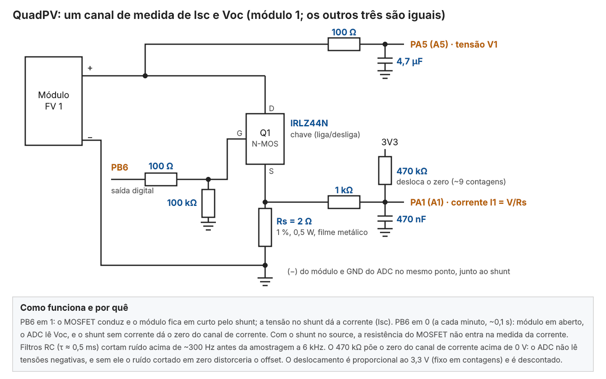

# QuadPV: Isc e Voc de quatro módulos fotovoltaicos lado a lado, com STM32

Sistema de baixo custo para comparar **coberturas** (vidro novo, vidro reusado, sem cobertura…) sobre **quatro módulos fotovoltaicos pequenos e idênticos**, expostos ao mesmo sol. Um **STM32F103C8T6 (Blue Pill)** mede, para cada módulo:

- a **corrente de curto-circuito (Isc)**, proporcional à luz que atravessa a cobertura e chega às células;
- a **tensão de circuito aberto (Voc)**, a cada minuto, que indica diferenças de temperatura entre os módulos.

A interface em Python mostra as razões entre os módulos com barra de erro, estima a diferença de temperatura, desconta as pequenas diferenças entre módulos (calibração) e grava tudo em CSV.


## Como funciona



Cada módulo fica em curto por um shunt de 2 Ω através de um MOSFET IRLZ44N usado como chave. A tensão no shunt dá a corrente. Uma vez por minuto o MOSFET abre por ~0,1 s: o ADC lê Voc e, com o shunt sem corrente, o zero do canal de corrente.

**Redução de ruído**

| Fonte de ruído ou erro | O que o QuadPV faz |
|---|---|
| Rede elétrica (60 Hz) e lâmpadas (120 Hz) | O ADC é disparado por timer a 6000 Hz exatos; cada média tem 6000 amostras = 60 ciclos de 60 Hz, e a interferência se cancela |
| Nuvens, variação do sol | Os 4 módulos são amostrados no mesmo instante (77 µs por varredura); as razões entre módulos cancelam a variação comum |
| Ruído aleatório do ADC | 6000 amostras por segundo por canal; com 1 min de média, o erro padrão da Isc relativa fica em ~0,003 % (simulação) |
| Offset e deriva dos canais de corrente | Zero medido a cada minuto, com o shunt sem corrente; um resistor de 470 kΩ mantém esse zero acima de 0 V, onde o ADC lê sem cortar |
| Variação do 3,3 V | Vrefint lida em toda varredura |
| Diferenças entre os módulos | Calibração com todos na mesma condição (botão **Calibrar módulos…**) |
| Ruído acima de ~300 Hz | Filtro RC em cada entrada do ADC |
| Sensores Hall (offset e deriva térmica) | Não há sensores Hall: um resistor de filme metálico praticamente não deriva |

## Hardware

| Componente | Função | Ligação |
|---|---|---|
| Blue Pill STM32F103C8T6 | Aquisição e USB | USB ao PC |
| 4 × MOSFET IRLZ44N | Chave: curto (Isc) ou aberto (Voc) | Gates em **PB6–PB9** |
| 4 × shunt 2 Ω 1 % | Corrente = tensão no shunt / 2 Ω | Entre o source e o GND; tensão em **PA1–PA4** |
| Filtros RC e 470 kΩ | Antirruído e deslocamento do zero | Ver o esquema |
| 4 módulos fotovoltaicos | Voc abaixo de 3,3 V | (+) em **PA5–PA7, PB0**, (−) no GND |

Detalhes, valores e cuidados de montagem em [docs/02_Hardware_e_Ligacoes.md](docs/02_Hardware_e_Ligacoes.md).

## Início rápido

1. Monte o hardware conforme [docs/02_Hardware_e_Ligacoes.md](docs/02_Hardware_e_Ligacoes.md).
2. Compile e grave [`firmware/quadpv_cube/`](firmware/quadpv_cube/) (STM32Cube) com o STM32CubeIDE, ou com `make flash` e um ST-Link ([docs/03_Firmware.md](docs/03_Firmware.md)).
3. Instale as dependências da interface (Python 3.10 ou superior; com o Miniconda, no Anaconda Prompt):
   ```bash
   pip install -r requirements.txt
   ```
4. Conecte a placa pelo USB e rode:
   ```bash
   python interface/quadpv.py
   ```
   A placa é encontrada sozinha, como no SOI: a interface procura o STM32 (USB VID 0x0483) e confirma com o comando `?` que é um QuadPV, então o SOI pode ficar ligado no mesmo PC. Sem a placa, marque **Simular medidas**.
5. Em *Configurar módulos…*, informe nomes, áreas e o valor medido de cada shunt.
6. **Calibre:** deixe os quatro módulos na mesma condição (mesma cobertura, ou nenhuma) por alguns minutos e clique em **Calibrar módulos…**.
7. Ponha as coberturas, digite o nome da amostra e clique em **Gravar**. Os arquivos vão para a pasta `Medidas/`.

## Documentação

| Documento | Conteúdo |
|---|---|
| [01_Materiais.md](docs/01_Materiais.md) | Hardware e software |
| [02_Hardware_e_Ligacoes.md](docs/02_Hardware_e_Ligacoes.md) | Esquema, pinos, valores e cuidados de montagem contra ruído |
| [03_Firmware.md](docs/03_Firmware.md) | Aquisição, janela de Voc, protocolo serial, gravação e teste sem a placa |
| [04_Interface.md](docs/04_Interface.md) | Funcionalidades da interface e formato dos arquivos |
| [05_Calibracao_e_Incertezas.md](docs/05_Calibracao_e_Incertezas.md) | Conversão, calibração, incertezas e a estimativa de ΔT |

## Estrutura do repositório

```
├── interface/
│   ├── quadpv.py            Interface (PySide6/PyQt + pyqtgraph)
│   └── quadpv_core.py       Protocolo, conversão, calibração, serial e simulação (sem interface gráfica)
├── firmware/quadpv_cube/    Firmware 3.x (STM32Cube HAL, USB CDC; Makefile e QuadPV.ioc)
├── firmware/teste_host/     O mesmo firmware rodando no PC contra um modelo (teste sem placa)
├── firmware/pv/pv.ino       Firmware original (Arduino), só como referência
├── docs/                    Documentação
├── packaging/               Spec e dependências do PyInstaller (executável Windows)
├── .github/workflows/       Geração automática do executável nas Releases
├── legado/pv-stm32.py       Interface original (Tkinter), só como referência
├── CHANGELOG.md             Histórico de versões
└── requirements.txt         Dependências Python
```

A versão com carga eletrônica (MOSFET + op-amp, curvas I–V e rastreamento do ponto de máxima potência) está no branch `carga-eletronica`.

## Versões

O que mudou em cada versão está no [CHANGELOG.md](CHANGELOG.md). O número aparece no título da janela.
