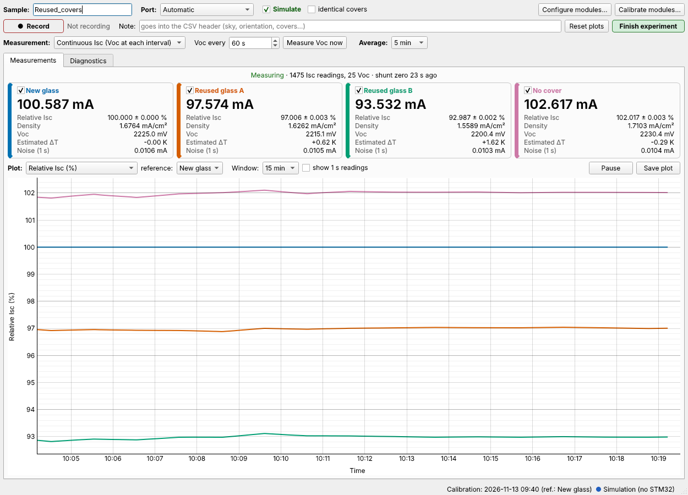

# QuadPV: Isc and Voc of four photovoltaic modules side by side, with an STM32

A low-cost system to compare **cover materials** (new glass, reused glass, no cover…) on **four small, identical photovoltaic modules** exposed to the same sun. An **STM32F103C8T6 (Blue Pill)** measures, for each module:

- the **short-circuit current (Isc)**, proportional to the light that passes through the cover and reaches the cells;
- the **open-circuit voltage (Voc)**, once a minute, which shows temperature differences between the modules.

The Python interface shows the ratios between modules with error bars, estimates the temperature difference, removes the small differences between modules (calibration) and writes everything to CSV.



## How it works


Each module is shorted through a 2 Ω shunt by an IRLZ44N MOSFET used as a switch. The shunt voltage gives the current. Once a minute the MOSFET opens for ~0.1 s: the ADC reads Voc and, with no current in the shunt, the zero of the current channel.

**Noise reduction**

| Noise or error source | What QuadPV does |
|---|---|
| Mains (60 Hz) and lamps (120 Hz) | A timer triggers the ADC at exactly 6000 Hz; each average has 6000 samples = 60 cycles of 60 Hz, so the interference cancels |
| Clouds, changing sunlight | The 4 modules are sampled at the same instant (77 µs per scan); the ratios between modules cancel the common variation |
| Random ADC noise | 6000 samples per second per channel; with a 1 min average, the standard error of the relative Isc is ~0.003 % (simulation) |
| Offset and drift of the current channels | Zero measured every minute with no current in the shunt; a 470 kΩ resistor keeps that zero above 0 V, where the ADC reads without clipping |
| Changes in the 3.3 V supply | Vrefint read in every scan |
| Differences between modules | Calibration with all of them under the same condition (**Calibrate modules…** button) |
| Noise above ~300 Hz | RC filter on each ADC input |
| Hall sensors (offset and thermal drift) | No Hall sensors: a metal-film resistor barely drifts |

## Hardware

| Component | Function | Connection |
|---|---|---|
| Blue Pill STM32F103C8T6 | Acquisition and USB | USB to the PC |
| 4 × IRLZ44N MOSFET | Switch: shorted (Isc) or open (Voc) | Gates on **PB6–PB9** |
| 4 × 2 Ω 1 % shunt | Current = shunt voltage / 2 Ω | Between source and GND; voltage on **PA1–PA4** |
| RC filters and 470 kΩ | Noise filtering and zero shift | See the schematic |
| 4 photovoltaic modules | Voc below 3.3 V | (+) on **PA5–PA7, PB0**, (−) to GND |

Details, values and assembly tips in [docs/02_Hardware_and_Wiring.md](docs/02_Hardware_and_Wiring.md).

## Quick start

1. Build the hardware following [docs/02_Hardware_and_Wiring.md](docs/02_Hardware_and_Wiring.md).
2. Build and flash [`firmware/quadpv_cube/`](firmware/quadpv_cube/) (STM32Cube) with STM32CubeIDE, or with `make flash` and an ST-Link ([docs/03_Firmware.md](docs/03_Firmware.md)).
3. Download the repository (*Code > Download ZIP*, or `git clone https://github.com/mbelancon/QuadPV`).
4. Connect the board over USB and open the interface:
   - **Windows:** double-click **`QuadPV.bat`**.
   - **Linux/macOS:** run `./quadpv.sh`.

   The script looks for an installed Python 3.10 or newer, such as Miniconda, Anaconda or the official Python. If a library is missing (numpy, pyserial, pyqtgraph, PySide6), it offers to install it with pip. Nothing but Python needs to be installed. Details and manual installation in [docs/04_Interface.md](docs/04_Interface.md#installation-and-running).

   The board is found automatically, as in the SOI project: the interface looks for the STM32 (USB VID 0x0483) and confirms with the `?` command that it is a QuadPV, so the SOI can stay plugged into the same PC. Without the board, check **Simulate**.
5. In *Configure modules…*, enter names, areas and the measured value of each shunt.
6. **Calibrate:** leave the four modules under the same condition (same cover, or none) for a few minutes and click **Calibrate modules…**.
7. Put the covers on, type the sample name and click **Record**. Files go to the `Measurements/` folder.

## Documentation

| Document | Contents |
|---|---|
| [01_Materials.md](docs/01_Materials.md) | Hardware and software |
| [02_Hardware_and_Wiring.md](docs/02_Hardware_and_Wiring.md) | Schematic, pins, values and assembly against noise |
| [03_Firmware.md](docs/03_Firmware.md) | Acquisition, Voc window, serial protocol, flashing and testing without the board |
| [04_Interface.md](docs/04_Interface.md) | Installation, interface features and file formats |
| [05_Calibration_and_Uncertainty.md](docs/05_Calibration_and_Uncertainty.md) | Conversion, calibration, uncertainty and the ΔT estimate |

## Repository layout

```
├── QuadPV.bat               Opens the interface on Windows (finds Miniconda, Anaconda or another Python)
├── quadpv.sh                Same for Linux and macOS
├── interface/
│   ├── quadpv.py            Interface (PySide6/PyQt + pyqtgraph)
│   └── quadpv_core.py       Protocol, conversion, calibration, serial and simulation (no GUI)
├── firmware/quadpv_cube/    Firmware 3.x (STM32Cube HAL, USB CDC; Makefile and QuadPV.ioc)
├── firmware/teste_host/     The same firmware running on the PC against a model (test without a board)
├── firmware/pv/pv.ino       Original firmware (Arduino), reference only
├── docs/                    Documentation
├── legacy/pv-stm32.py       Original interface (Tkinter), reference only
├── CONTEXT.md               Short project context for developers (and for AI assistants)
├── CHANGELOG.md             Version history
├── LICENSE                  GPL-3.0
└── requirements.txt         Python dependencies
```

The firmware source comments are in Portuguese. The version with an electronic load (MOSFET + op-amp, I–V curves and maximum power point tracking) is in the `carga-eletronica` branch.

## Versions

What changed in each version is in [CHANGELOG.md](CHANGELOG.md). The version number appears in the window title.

## License

Distributed under the GPL-3.0 license (GNU General Public License v3.0). See [LICENSE](LICENSE).

The STMicroelectronics and Arm libraries in `firmware/quadpv_cube/Drivers/` and `firmware/quadpv_cube/Middlewares/` keep their own licenses, in the `LICENSE` file of each folder.
