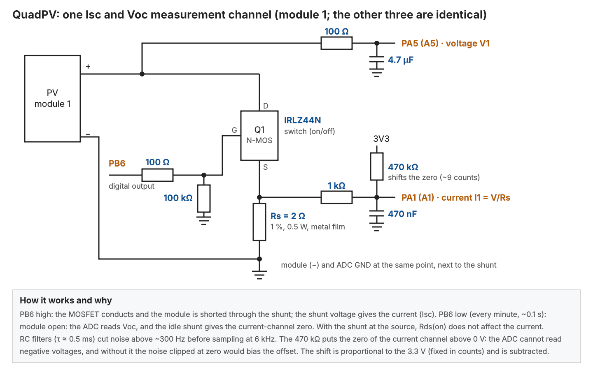

# 2. Hardware and wiring

## One channel

- **Switch:** the MOSFET (IRLZ44N) connects the module (+) to the shunt. With 3.3 V on the gate it conducts, and the module is shorted through the shunt. With the gate at 0, the module is open.
- **Shunt at the source:** the current is read from the shunt voltage (2 Ω), between source and GND. The MOSFET resistance is not part of this measurement, so it does not matter that it is only guaranteed from 4 V on the gate. It only adds a little to the module voltage during Isc: at 120 mA the module sits at ~0.25 V, on the flat part of the I–V curve, where the current equals Isc to much better than 1 %.
- **IRLZ44N with 3.3 V on the gate:** the maximum threshold is 2 V. With ~3 V on the gate (3.3 V minus the shunt drop) it easily conducts the 100–300 mA of small modules. Avoid MOSFETs without the "L" (IRFZ44N, IRF540) and the small 2N7000/BS170, whose threshold can reach 3–4 V.

## Pins

| Pin | Signal |
|---|---|
| PA1–PA4 | Shunt voltage (current) of modules 1–4 |
| PA5, PA6, PA7, PB0 | Voltage of modules 1–4 |
| PB6–PB9 | MOSFET gates of modules 1–4 |
| PA0, PB1 | Free (analog inputs; e.g. an irradiance sensor) |
| PA11, PA12 | USB |
| PA13, PA14 | SWD (ST-Link) |
| PC13 | Board LED (toggles at each reading) |

## Values and why

| Component | Value | Reason |
|---|---|---|
| Shunt | 2 Ω, 1 %, 0.5 W, metal film | ~240 mV at 120 mA (~300 ADC counts), still on the flat part of the I–V curve. Metal film drifts ~50 ppm/K. Dissipates ~30 mW |
| Current filter | 1 kΩ + 470 nF | Cuts above ~340 Hz, before sampling at 6 kHz. The pin leakage current (up to 1 µA) produces at most 1 mV on this resistor, and that error is part of the zero measured every minute |
| Zero shift | 470 kΩ from 3V3 to the current input | With no current the shunt is at 0 V, and the ADC cannot read negative voltages: the noise would be clipped at zero and the measured offset would be biased. With 470 kΩ and the 1 kΩ of the filter, the zero sits at ~7 mV (~9 counts). The shift is proportional to the 3.3 V, so it is fixed in counts, and it is subtracted together with the offset |
| Voltage filter | 100 Ω + 4.7 µF | Same bandwidth as the current filter. The resistor is small so the leakage current adds no more than 0.1 mV to Voc, because 1 mV of ΔVoc corresponds to ~0.1 K of ΔT |
| Gate | 100 Ω in series, 100 kΩ to GND | The 100 kΩ keeps the MOSFET off when the board is unpowered |
| Decoupling | 10 µF + 100 nF between 3V3 and GND | The 3.3 V supplies the ADC; noise on it becomes measurement noise |

**Different current range:** choose the shunt so that Isc × R stays between 0.15 V and ~10 % of Voc. Below that the resolution drops; above it the module leaves the flat part of the curve and the measured current falls below Isc.

## Assembly against noise

- **Star ground:** the (−) of each module, the low side of the shunt and the ADC ground meet at a single point next to the shunts, and from there a single wire goes to the Blue Pill GND. Module currents must not flow through the ADC ground wire.
- **Kelvin connection at the shunt:** the ADC input (through 1 kΩ) is taken directly from the shunt leg, not from a point on the track carrying the current.
- **Twisted pair** from the modules to the board, one pair per module. Long loose wires pick up 60 Hz.
- **Filters next to the pins:** the 470 nF and 4.7 µF capacitors sit right at the Blue Pill pins, with their ground at the star point.
- **Same wiring on the four channels:** the modules are compared with each other, and wiring differences become measurement differences (the calibration corrects the constant ones).
- **Power:** a laptop on battery is the cleanest source. If the PC is on mains power and noise is a problem, a USB isolator solves it; the Diagnostics tab shows the noise of each channel.

## Limits

- **All inputs must stay between 0 and 3.3 V.** The Voc of the modules must stay below that under any condition (cold days raise Voc). For larger modules, use a resistive divider on the voltage input and enter the factor in *Configure modules…*. Isc has no such problem: the shunt voltage is small.
- The interface warns when any input reaches 3.3 V.
