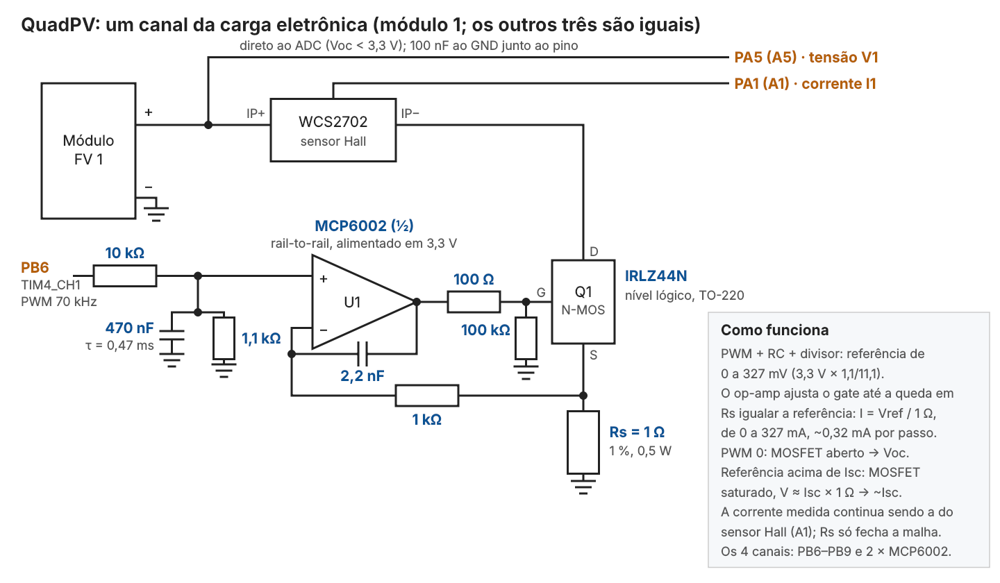

# 2. Hardware e ligações

Há duas montagens. A **carga eletrônica** (firmware 2.x) é a recomendada: mede a curva I–V e mantém cada módulo no ponto de máxima potência. A **carga fixa** é a montagem original, com um resistor por módulo; ela continua funcionando com o firmware antigo.

## Carga eletrônica (firmware 2.x)



Em cada canal, um MOSFET com um resistor de 1 Ω no source faz o papel da carga. Um amplificador operacional fecha a malha: ele ajusta o gate até a queda no resistor igualar uma referência que vem do PWM do STM32 (filtrado por RC e reduzido por um divisor). Assim a carga é uma **fonte de corrente programável**, linear no PWM:

| PWM (0–1023) | Referência | Corrente pedida | Situação do módulo |
|---|---|---|---|
| 0 | 0 mV | 0 | MOSFET aberto: **Voc** |
| *n* | 3,3 V × *n*/1023 × 1,1/11,1 | ≈ 0,32 mA × *n* | ponto qualquer da curva I–V |
| acima de Isc | | mais que o módulo fornece | MOSFET saturado, V ≈ Isc × 1 Ω: **≈ Isc** |

### Por que o amplificador operacional

Ligar o PWM filtrado direto no gate é mais simples, mas a corrente de dreno depende do quadrado de (Vgs − Vth). Perto do ponto de máxima potência, um passo do PWM (3,2 mV no gate) muda a corrente em ~4 %, e o limiar Vth varia com a temperatura. Simulando o firmware com os dois circuitos, depois de uma nuvem e da volta do sol:

| Carga | Potência rastreada pelo MPPT, em % do máximo |
|---|---|
| Gate direto (PWM + RC) | 72 a 99,7 % |
| Com op-amp (este esquema) | 99,9 a 100 % |

Com o op-amp, a corrente passa a ser ~0,32 mA por passo, de 0 a 327 mA, sem depender de Vth.

### Componentes por canal

| Item | Valor | Observação |
|---|---|---|
| Q1 | IRLZ44N (ou outro N-MOS de nível lógico em TO-220) | Precisa conduzir a Isc com ~3 V no gate. No ponto de máxima potência dissipa quase toda a potência do módulo (~0,25 W nos módulos atuais): TO-220 sem dissipador basta; SOT-23 (AO3400) só para módulos bem menores |
| Rs | 1 Ω, 1 %, 0,5 W | Fecha a malha do op-amp. Dissipa Isc² × 1 Ω (~15 mW) |
| U1 | ½ MCP6002 | Rail-to-rail, alimentado pelo 3V3 da Blue Pill; um MCP6002 atende dois canais. Capacitor de 100 nF entre VDD e GND junto ao CI |
| Divisor e filtro | 10 kΩ + 1,1 kΩ ∥ 470 nF | Referência de 0 a 327 mV; constante de tempo de 0,47 ms (ondulação do PWM de ~2,5 mV pico a pico) |
| Gate | 100 Ω em série, 100 kΩ ao GND | O de 100 kΩ mantém o MOSFET desligado com a placa sem alimentação |
| Compensação | 1 kΩ na realimentação, 2,2 nF da saída à entrada inversora | Estabiliza a malha com a capacitância do gate |

**Outra faixa de corrente.** A corrente máxima é `3,3 V × R2/(R1 + R2) / Rs`. Para módulos com outra Isc, mude o divisor (R1 = 10 kΩ, R2 = 1,1 kΩ) para que o máximo fique entre 1,5 e 3 vezes a Isc. Isso mantém a resolução boa e ainda permite chegar ao curto-circuito. A interface não precisa saber o valor: ela mede a corrente pelo sensor Hall.

### Pinos

| Pino Arduino | Pino STM32 | Sinal |
|---|---|---|
| A0 | PA0 | Sensor de referência (sem corrente) |
| A1–A4 | PA1–PA4 | Corrente dos módulos 1–4 (sensores Hall) |
| A5–A8 | PA5–PA7, PB0 | Tensão dos módulos 1–4 |
| — | PB6–PB9 | PWM da referência da carga dos módulos 1–4 (TIM4_CH1–CH4) |
| — | PB1 | Livre (entrada analógica, ex.: sensor de irradiância) |
| — | PA11, PA12 | USB |
| — | PA13, PA14 | SWD (ST-Link) |
| — | PC13 | LED da placa (pisca a cada leitura) |

## Carga fixa (montagem original)

```
 módulo (+) ──┬───────────────────────────────── entrada de tensão (A5..A8)
              │
              └── IP+ [WCS2702] IP− ── carga R ── GND
                        │
                     saída ─────────────────────── entrada de corrente (A1..A4)

 módulo (−) ── GND
```

Nas duas montagens:

- O (−) de todos os módulos vai ao **GND da Blue Pill**. A tensão medida é a do terminal (+) do módulo.
- A corrente do módulo passa pelo sensor Hall e pela carga até o GND.
- Um quinto sensor, **sem corrente**, vai em **A0**. Ele acompanha a deriva comum dos sensores (alimentação e temperatura), que a interface desconta das leituras de A1–A4.

*(a completar: a alimentação dos sensores Hall, 3,3 V ou 5 V.)*

## Limites e cuidados

- **Todas as entradas devem ficar entre 0 e 3,3 V.** A tensão de circuito aberto dos módulos precisa ficar abaixo disso em qualquer condição (dias frios aumentam a tensão). Para módulos maiores, use um divisor resistivo e informe o fator em *Configurar módulos…*.
- Sensores Hall têm a saída centrada em metade da alimentação. **Se os WCS2702 forem alimentados com 5 V**, a saída em repouso fica perto de 2,5 V e a corrente máxima medível antes de saturar o ADC (3,3 V) é limitada. Confira com a sensibilidade do sensor. A interface avisa quando alguma entrada encosta em 0 ou em 3,3 V.
- Com carga fixa, o módulo não trabalha no ponto de máxima potência na maior parte do dia (ver [05](05_Calibracao_e_Incertezas.md#qual-grandeza-comparar)). A carga eletrônica resolve isso.
- Mantenha as fiações dos quatro canais iguais: resistências de fio diferentes mudam o ponto de operação e quebram a comparação entre módulos idênticos.
