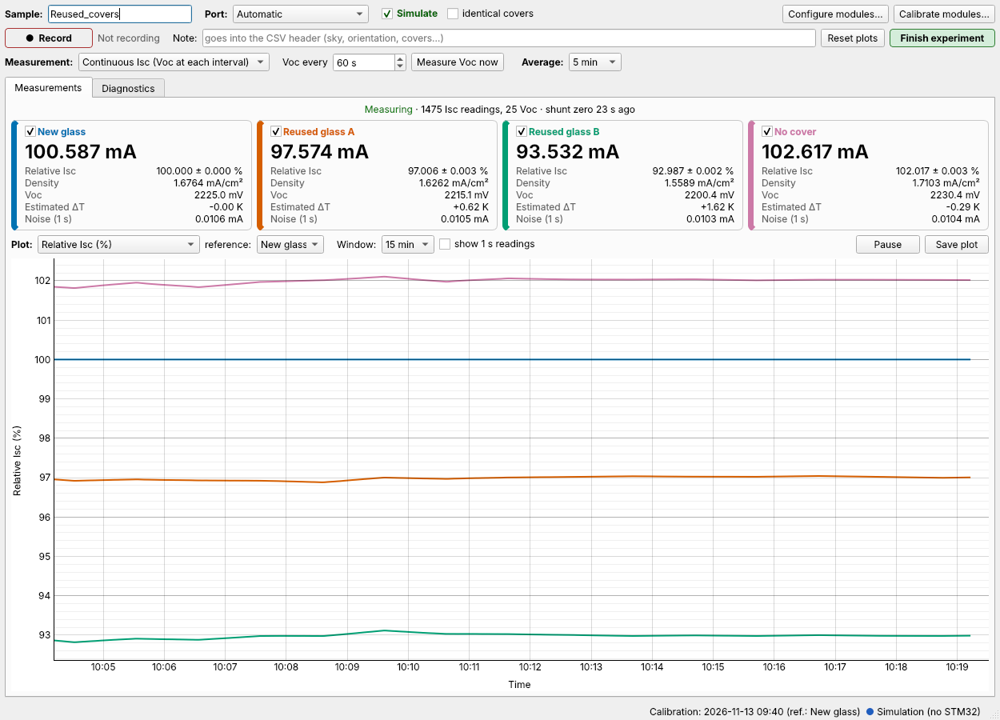
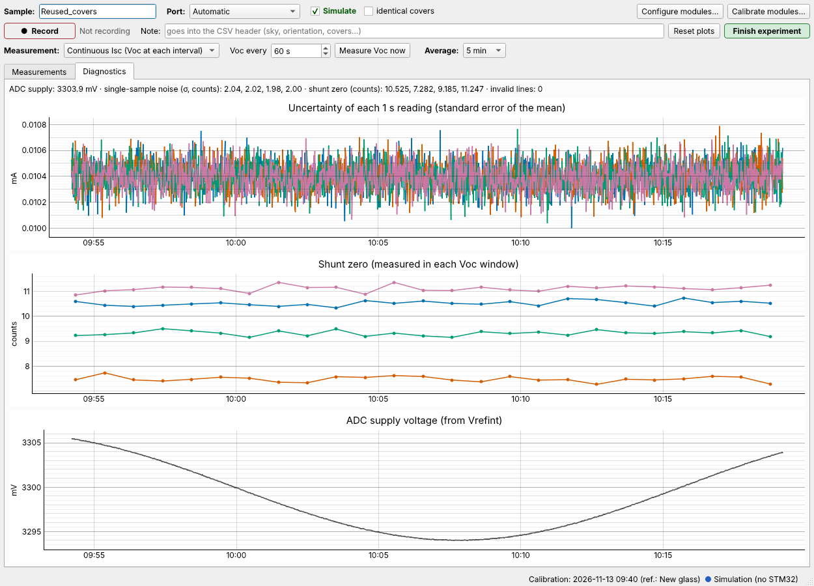

# 4. PC interface – QuadPV

Files: [`interface/quadpv.py`](../interface/quadpv.py) (window) and [`interface/quadpv_core.py`](../interface/quadpv_core.py) (protocol, calculations, serial and simulation). PySide6 (or PyQt) + pyqtgraph, in the same style as the SOI Controller.

## Installation and running

The interface runs with a Python already installed on the computer (3.10 or newer). There is no portable version yet.

**Simplest way:**
- **Windows:** double-click **`QuadPV.bat`**, in the main folder of the repository.
- **Linux and macOS:** `./quadpv.sh`.

The script looks for Python in this order and uses the first one it finds:

| Order | Where | Windows example |
|---|---|---|
| 1 | `QUADPV_PYTHON` environment variable | `C:\Users\you\miniconda3\envs\quadpv\python.exe` |
| 2 | `.venv` virtual environment in the QuadPV folder | `.venv\Scripts\python.exe` |
| 3 | Miniconda, Anaconda, Miniforge or Mambaforge in the user folder, in `%LOCALAPPDATA%`, in `%ProgramData%` or in `C:\` | `C:\Users\you\miniconda3\python.exe` |
| 4 | Official Python: `py` launcher and `%LOCALAPPDATA%\Programs\Python\Python3*` | `C:\Users\you\AppData\Local\Programs\Python\Python312\python.exe` |
| 5 | `python` on the PATH | |

On Linux and macOS the order is the same, with `~/miniconda3`, `~/anaconda3`, `~/miniforge3`, `~/mambaforge`, `/opt/miniconda3`, `/opt/anaconda3` and finally `python3`/`python`.

When Miniconda or Anaconda is used without activating the environment, `QuadPV.bat` adds its library folders (`Library\bin`, `Scripts`) to the PATH so the DLLs are found.

If a library is missing, the script asks whether it may run `pip install -r requirements.txt` with the chosen Python. This is needed only once.

**Separate environment (recommended if you use Python for other things):**

```bash
conda create -n quadpv python=3.12
conda activate quadpv
pip install -r requirements.txt
```

Then point the launcher to it (Windows, once, in the Command Prompt):

```bat
setx QUADPV_PYTHON "%USERPROFILE%\miniconda3\envs\quadpv\python.exe"
```

Without conda, a virtual environment in the QuadPV folder is found automatically:

```bash
python -m venv .venv
.venv\Scripts\pip install -r requirements.txt      # Windows
.venv/bin/pip install -r requirements.txt          # Linux/macOS
```

On Linux, recent distributions block `pip install` on the system Python; in that case use the `.venv` above.

**Manually**, with any Python that has the libraries:

```bash
pip install -r requirements.txt
python interface/quadpv.py
```

## Connection

The board is found automatically, as in the SOI:

- **Automatic port:** tries, in this order, the `QUADPV_PORT` environment variable (e.g. `COM7`), a USB device named "QuadPV" (Linux and macOS show the name), devices with VID `0x0483` (STM32), other known boards and, finally, the only USB port present.
- **Identity check:** the SOI and the QuadPV use the same VID/PID. When opening a port, the interface sends `?` and waits up to 2.5 s:
  - `# QuadPV fw 3.…` or `D`/`V` lines: it is a QuadPV, and the interface connects.
  - Firmware 2.x or the original one: connects, but shows **"Incompatible firmware"** and ignores the data.
  - Nothing recognizable (for example, the SOI binary data): the port is skipped for 30 s and the search goes on.

  So both boards can stay plugged into the same PC.
- The **Port** list lets you pin a port, which is saved.
- If the connection drops, the interface tries to reconnect every 3 s and sends the chosen mode and Voc interval again.
- **Without the board**, check **Simulate**. The simulation mimics the firmware:
  - covers with 100 %, 97 %, 93 % and 102 % transmittance, which heat the modules differently;
  - modules that differ slightly from each other;
  - clouds and drift of the 3.3 V.

  The **identical covers** option puts all of them under the same condition, to test the calibration.
- Preferences (names, areas, shunts, calibration, port, windows) are saved on closing (on Windows, in `HKCU\Software\LCTM\QuadPV`).

## Controls

| Control | Function |
|---|---|
| Sample | Prefix of the files saved in `Measurements/` |
| Configure modules… | Name, area, measured shunt value and voltage divider of each module; ADC supply from Vrefint (with calibration from the 3V3 measured with a multimeter) or fixed; parameters of the ΔT estimate |
| Calibrate modules… | With the four modules under the same condition, uses the averaging window (at least 60 s) to measure the Isc ratio and the Voc difference of each module relative to the reference one, and corrects for them from then on. **Reset** goes back to no calibration |
| Record / Stop | Writes each reading as it arrives |
| Measurement | **Continuous Isc** (Voc at each interval) or **Continuous Voc** |
| Voc every | Interval between Voc measurements (0 = only with the button). Each measurement leaves one second without Isc |
| Measure Voc now | One Voc measurement in the next second |
| Average | Moving-average window for the cards and the Isc plots: 1 s to 15 min |

## Measurements tab



- **Module cards**, with averages over the chosen window:
  - Isc;
  - Isc relative to the reference module, with its standard error;
  - current density;
  - latest Voc and the estimated ΔT;
  - noise of a 1 s reading.
- **Plot:** relative Isc, Isc, current density, Voc, ΔVoc or estimated ΔT. The Voc quantities appear as points, one per measurement. **Show 1 s readings** draws the individual readings behind the moving average.
- **Reference:** the module that is 100 % in the relative quantities and 0 in ΔVoc and ΔT (usually the one with the standard cover).
- **Pause** freezes the plot and enables zoom and pan; **Save plot** writes the CSV and PNG of the visible range.

**Why look at relative Isc:** the four modules are sampled at the same instant. When a cloud passes, the four currents drop together, and the ratio does not change. That is why the relative Isc is much less noisy than the absolute Isc, which follows the sun.

## Diagnostics tab



- **Uncertainty of each 1 s reading:** the standard error of the mean, in mA, from the standard deviation sent by the firmware. An increase points to new noise (power supply, wiring, a device switched on nearby).
- **Shunt zero:** measured in each Voc window. It should stay stable near ~9 counts (the 470 kΩ shift plus the ADC offset).
- **ADC supply voltage**, from Vrefint.
- **Text:** single-sample σ of each channel, current zero and invalid lines received.

## Files

Recording creates two files with a `#` header that includes the configuration, the calibration and the formulas. The column names are in Portuguese (`datahora` = date/time, `Vcurto` = voltage while shorted, `zero` = shunt zero).

**`<sample>_QuadPV_<date>.csv`**, one row per second:

| Column | Contents |
|---|---|
| `datahora`, `t_s` | PC time and time since the start |
| `I1_mA`…`I4_mA` | Isc with the module calibration |
| `Ierr1_mA`…`Ierr4_mA` | Standard error of the 1 s mean |
| `Vcurto1_mV`… | Module voltage during Isc (should be close to Isc × 2 Ω) |
| `VDDA_mV` | ADC supply |
| `a1`…`a4`, `v1`…`v4`, `r` | ADC counts (allow redoing the calculations) |
| `zero1`…`zero4` | Shunt zero used in each row |
| `sigma_a1`…, `n` | Single-sample standard deviation and number of samples |

**`<sample>_QuadPV_<date>_Voc.csv`**, one row per Voc measurement:

| Column | Contents |
|---|---|
| `Voc1_mV`… | Voc with the module calibration |
| `dVoc1_mV`… | Difference from the reference module |
| `dT1_K`… | Estimated ΔT (see [05](05_Calibration_and_Uncertainty.md#δt-estimate-from-voc)) |
| `Isc10s1_mA`… | Mean Isc of the previous 10 s, used for ΔT |
| `zero1`…, `v1`…, `r`, `n` | Counts of the Voc window |
