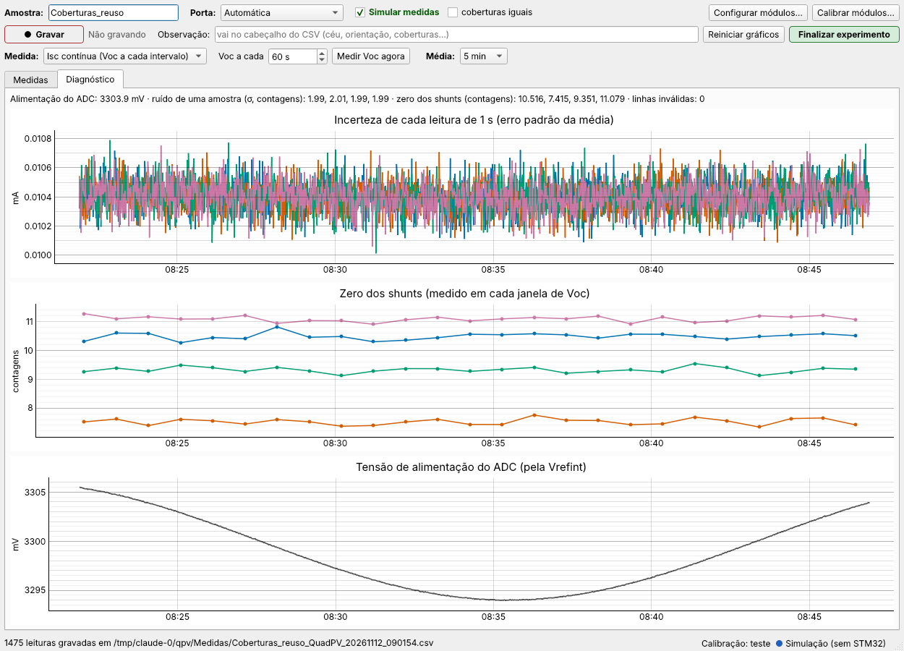

# 4. Interface no PC – QuadPV

Arquivos: [`interface/quadpv.py`](../interface/quadpv.py) (janela) e [`interface/quadpv_core.py`](../interface/quadpv_core.py) (protocolo, contas, serial e simulação). PySide6 (ou PyQt) + pyqtgraph, no mesmo padrão do SOI Controller.

## Instalação e execução

A interface roda com um Python já instalado no computador (3.10 ou mais novo). Ainda não há versão portátil.

**Jeito mais simples:**
- **Windows:** dois cliques em **`QuadPV.bat`**, na pasta principal do repositório.
- **Linux e macOS:** `./quadpv.sh`.

O script procura o Python nesta ordem e usa o primeiro que achar:

| Ordem | Onde | Exemplo no Windows |
|---|---|---|
| 1 | Variável de ambiente `QUADPV_PYTHON` | `C:\Users\voce\miniconda3\envs\quadpv\python.exe` |
| 2 | Ambiente virtual `.venv` na pasta do QuadPV | `.venv\Scripts\python.exe` |
| 3 | Miniconda, Anaconda, Miniforge ou Mambaforge na pasta do usuário, em `%LOCALAPPDATA%`, em `%ProgramData%` ou em `C:\` | `C:\Users\voce\miniconda3\python.exe` |
| 4 | Python oficial: lançador `py` e `%LOCALAPPDATA%\Programs\Python\Python3*` | `C:\Users\voce\AppData\Local\Programs\Python\Python312\python.exe` |
| 5 | `python` do PATH | |

No Linux e no macOS a ordem é a mesma, com `~/miniconda3`, `~/anaconda3`, `~/miniforge3`, `~/mambaforge`, `/opt/miniconda3`, `/opt/anaconda3` e por fim `python3`/`python`.

Ao usar o Miniconda ou o Anaconda sem ativar o ambiente, o `QuadPV.bat` põe as pastas de bibliotecas dele (`Library\bin`, `Scripts`) no PATH, para as DLLs serem encontradas.

Se faltar alguma biblioteca, o script pergunta se pode rodar `pip install -r requirements.txt` com o Python escolhido. Isso é feito uma vez só.

**Ambiente separado (recomendado se você usa o Python para outras coisas):**

```bash
conda create -n quadpv python=3.12
conda activate quadpv
pip install -r requirements.txt
```

Depois aponte o lançador para ele (Windows, uma vez, no Prompt de Comando):

```bat
setx QUADPV_PYTHON "%USERPROFILE%\miniconda3\envs\quadpv\python.exe"
```

Sem conda, um ambiente virtual na própria pasta é encontrado sozinho:

```bash
python -m venv .venv
.venv\Scripts\pip install -r requirements.txt      # Windows
.venv/bin/pip install -r requirements.txt          # Linux/macOS
```

No Linux, distribuições recentes bloqueiam o `pip install` no Python do sistema; nesse caso use o `.venv` acima.

**Manualmente**, com qualquer Python que tenha as bibliotecas:

```bash
pip install -r requirements.txt
python interface/quadpv.py
```

## Conexão

A placa é encontrada sozinha, como no SOI:

- **Porta automática:** testa, nesta ordem, a variável de ambiente `QUADPV_PORT` (ex.: `COM7`), um dispositivo USB chamado "QuadPV" (Linux e macOS mostram o nome), os dispositivos com VID `0x0483` (STM32), outras placas conhecidas e, por fim, a única porta USB presente.
- **Confirmação da identidade:** o SOI e o QuadPV usam o mesmo VID/PID. Ao abrir uma porta, a interface manda `?` e espera até 2,5 s:
  - `# QuadPV fw 3.…` ou linhas `D`/`V`: é o QuadPV, e a interface conecta.
  - Firmware 2.x ou o antigo: conecta, mas avisa **"Firmware incompatível"** e ignora os dados.
  - Nada reconhecível (por exemplo, os dados binários do SOI): a porta é recusada por 30 s e a busca continua.

  Assim as duas placas podem ficar ligadas no mesmo PC.
- A lista **Porta** permite fixar uma porta, que fica salva.
- Se a conexão cair, a interface tenta reconectar a cada 3 s e reenvia o modo e o intervalo de Voc escolhidos.
- **Sem a placa**, marque **Simular medidas**. A simulação imita o firmware:
  - coberturas de transmitância 100 %, 97 %, 93 % e 102 %, que aquecem os módulos de forma diferente;
  - módulos que diferem um pouco entre si;
  - nuvens e deriva do 3,3 V.

  A opção **coberturas iguais** põe todos na mesma condição, para testar a calibração.
- As preferências (nomes, áreas, shunts, calibração, porta, janelas) ficam salvas ao fechar (no Windows, em `HKCU\Software\LCTM\QuadPV`).

## Controles

| Controle | Função |
|---|---|
| Amostra | Prefixo dos arquivos salvos em `Medidas/` |
| Configurar módulos… | Nome, área, valor medido do shunt e divisor de tensão de cada módulo; tensão do ADC pela Vrefint (com calibração pelo 3V3 medido no multímetro) ou fixa; parâmetros da estimativa de ΔT |
| Calibrar módulos… | Com os quatro módulos na mesma condição, usa a janela de média (mínimo 60 s) para medir a razão de Isc e a diferença de Voc de cada módulo em relação ao de referência, e passa a descontá-las. **Redefinir** volta a não calibrar |
| Gravar / Parar | Grava cada leitura assim que chega |
| Medida | **Isc contínua** (Voc a cada intervalo) ou **Voc contínua** |
| Voc a cada | Intervalo das medidas de Voc (0 = só no botão). Cada medida deixa um segundo sem Isc |
| Medir Voc agora | Uma medida de Voc no próximo segundo |
| Média | Janela da média móvel dos cartões e dos gráficos de Isc: 1 s a 15 min |

## Aba Medidas


- **Cartões dos módulos**, com médias na janela escolhida:
  - Isc;
  - Isc relativa ao módulo de referência, com o erro padrão;
  - densidade de corrente;
  - última Voc e o ΔT estimado;
  - ruído de uma leitura de 1 s.
- **Gráfico:** Isc relativa, Isc, densidade de corrente, Voc, ΔVoc ou ΔT estimado. As grandezas de Voc aparecem como pontos, uma por medida. **Mostrar leituras de 1 s** desenha as leituras individuais atrás da média móvel.
- **Referência:** o módulo que vale 100 % nas grandezas relativas e 0 em ΔVoc e ΔT (normalmente o de cobertura padrão).
- **Pausar** congela o gráfico e libera zoom e arraste; **Salvar gráfico** grava o CSV e o PNG do trecho visível.

**Por que olhar a Isc relativa:** os quatro módulos são amostrados no mesmo instante. Quando uma nuvem passa, as quatro correntes caem juntas, e a razão não muda. Por isso a Isc relativa tem muito menos ruído que a Isc absoluta, que varia com o sol.

## Aba Diagnóstico



- **Incerteza de cada leitura de 1 s:** o erro padrão da média, em mA, a partir do desvio-padrão que o firmware manda. Um aumento indica ruído novo (fonte, fiação, um equipamento ligado perto).
- **Zero dos shunts:** medido em cada janela de Voc. Deve ficar estável perto de ~9 contagens (o deslocamento do 470 kΩ mais o offset do ADC).
- **Tensão de alimentação do ADC**, pela Vrefint.
- **Texto:** σ de uma amostra de cada canal, zero atual e linhas inválidas recebidas.

## Arquivos

A gravação cria dois arquivos com cabeçalho `#`, que inclui a configuração, a calibração e as fórmulas.

**`<amostra>_QuadPV_<data>.csv`**, uma linha por segundo:

| Coluna | Conteúdo |
|---|---|
| `datahora`, `t_s` | Horário do PC e tempo desde o início |
| `I1_mA`…`I4_mA` | Isc com a calibração dos módulos |
| `Ierr1_mA`…`Ierr4_mA` | Erro padrão da média de 1 s |
| `Vcurto1_mV`… | Tensão do módulo durante a Isc (deve ficar perto de Isc × 2 Ω) |
| `VDDA_mV` | Alimentação do ADC |
| `a1`…`a4`, `v1`…`v4`, `r` | Contagens do ADC (permitem refazer as contas) |
| `zero1`…`zero4` | Zero dos shunts usado em cada linha |
| `sigma_a1`…, `n` | Desvio-padrão de uma amostra e número de amostras |

**`<amostra>_QuadPV_<data>_Voc.csv`**, uma linha por medida de Voc:

| Coluna | Conteúdo |
|---|---|
| `Voc1_mV`… | Voc com a calibração dos módulos |
| `dVoc1_mV`… | Diferença em relação ao módulo de referência |
| `dT1_K`… | ΔT estimado (ver [05](05_Calibracao_e_Incertezas.md#estimativa-de-δt-pela-voc)) |
| `Isc10s1_mA`… | Isc média dos 10 s anteriores, usada no ΔT |
| `zero1`…, `v1`…, `r`, `n` | Contagens da janela de Voc |
